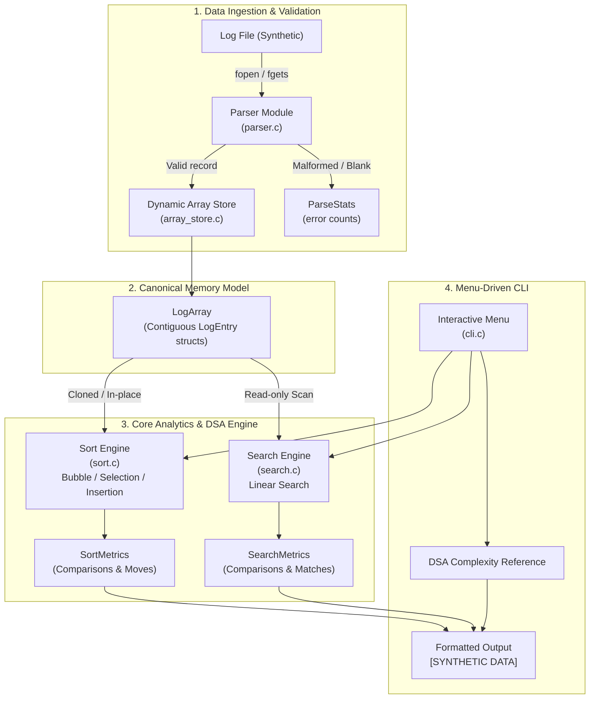
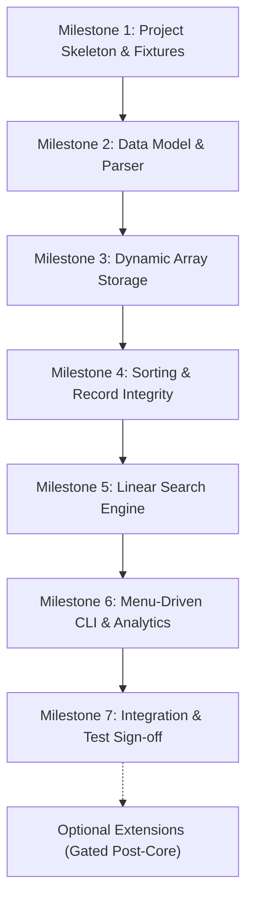

# LogWatch — Implementation Plan

**Version:** 2.0 (Scoped Core Release & Extension Roadmap)  
**Date:** 2026-10-12  
**Course:** CSC2101 — Data Structures and Algorithms (July–November 2026)  
**Status:** Architecture & Implementation Plan for Core Release (Awaiting Developer Approval)

---

## 1. Repository Audit and Scope Overview

### 1.1 Repository Audit

| Item | Status | Notes |
|---|---|---|
| Source Files | Fresh start | No legacy C source files. Architecture created clean. |
| Log Samples | Synthetic only | No verified CodeVault production logs exist. Synthetic pipe-delimited format is the canonical format. |
| Toolchain | MinGW GCC 6.3.0 | GCC available on PATH. Makefile and batch/PowerShell build scripts supported. |
| Target Standard | C11 | `-std=c11 -Wall -Wextra -pedantic` with zero warnings. |
| External Libraries | None | Standard C library only (`stdio.h`, `stdlib.h`, `string.h`, `stdbool.h`, `time.h`). |

### 1.2 Core Release vs. Optional Extensions Summary

To ensure high quality, correctness, explainability, and testability for a small team project, LogWatch is strictly partitioned into:

1. **Core Initial Release (Milestones 1–7)**:
   - Robust pipe-delimited file parsing & error reporting.
   - Dynamic array storage (`LogArray`) with amortized $O(1)$ capacity growth.
   - In-place sorting of complete records: Bubble Sort, Selection Sort, and Insertion Sort.
   - Linear Search supporting multiple criteria and duplicate matches.
   - Operation-count metrics (`SortMetrics`, `SearchMetrics`) and theoretical asymptotic analysis.
   - Interactive, menu-driven command-line interface.
   - Comprehensive automated unit and integration tests.

2. **Optional Extensions (Gated Milestones 8+)**:
   - Singly Linked Lists, Stacks, Queues, Recursion Demos, BST, AVL Trees, Heaps/Heap Sort, Hash Tables, and Route Graphs.
   - Strictly deferred until the Core Release is approved, verified, and each extension's syllabus eligibility and value are confirmed.

---

## 2. Authoritative Syllabus and Algorithm Classification

The actual course handout (CSC2101) and topics completed in class are the authoritative source. Topics are not assumed covered merely by lecture number.

### 2.1 Algorithm Classification Matrix

| Topic / Algorithm | Status in Class | Project Classification | Milestone | Rationale & Inclusion Decision |
|---|---|---|---|---|
| **Dynamic Array (`LogArray`)** | Covered | **Core** | M2, M3 | Foundational contiguous storage; essential for all subsequent operations. |
| **Bubble Sort** | Covered | **Core** | M4 | Elementary comparison sort; demonstrates adaptive early termination on sorted input. |
| **Selection Sort** | Covered | **Core** | M4 | Elementary sort; minimizes record write operations ($O(n)$ swaps). |
| **Insertion Sort** | Covered | **Core** | M4 | Elementary adaptive sort; $O(n)$ best-case for nearly-sorted access logs. |
| **Linear Search** | Covered | **Core** | M5 | Baseline $O(n)$ search; works on unsorted logs and extracts all matching records. |
| **Complexity & Operation Counters** | Covered | **Core** | M4, M5, M6 | Pedagogical $O, \Omega, \Theta$ reference plus runtime comparison and move counters. |
| **Singly Linked Lists** | Covered | **Optional Extension** | M8.1 | Alternative dynamic storage; evaluate only after Core is signed off. |
| **Stacks & Queues** | Covered | **Optional Extension** | M8.2 | Access logs lack paired lifecycle events; deferred to synthetic event demo. |
| **Recursion Demos** | Covered | **Optional Extension** | M8.3 | Factorial, Fibonacci, Hanoi; auxiliary pedagogical module. |
| **Binary Search Tree (BST)** | Covered | **Optional Extension** | M8.4 | Range query indexing; requires duplicate bucket design. |
| **AVL Tree** | Covered | **Optional Extension** | M8.5 | Self-balancing tree; requires complex rotation handling. |
| **Max-Heap & Heap Sort** | Covered | **Optional Extension** | M8.6 | Top-N ranking; evaluate value after Core sorting is solid. |
| **Hash Table (Chaining)** | Covered | **Optional Extension** | M8.7 | $O(1)$ average route/status lookups; secondary indexing. |
| **Graphs (BFS / DFS)** | Covered | **Optional Extension** | M8.8 | Route co-occurrence navigation; strictly optional. |
| **Binary Search (Divide & Conquer)** | Scheduled (L43) | **Not Yet Covered** | Deferred | Divide-and-conquer binary search scheduled at L43; gated. |
| **Merge Sort** | Scheduled (L44) | **Not Yet Covered** | Deferred | Scheduled at Lecture 44; strictly deferred. |
| **Quick Sort** | Scheduled (L45) | **Not Yet Covered** | Deferred | Scheduled at Lecture 45; strictly deferred. |
| **Recurrence Solving (Master Thm)** | Scheduled (L38–41) | **Not Yet Covered** | Deferred | Formal recurrence methods scheduled at L38–41; deferred. |

---

## 3. Architecture and Data Flow

### 3.1 High-Level Architecture (Core Release)



### 3.2 Data Ownership and Invariant Rules

1. **Single Source of Truth**: `LogArray` owns the dynamically allocated contiguous array of `LogEntry` structures.
2. **Record Integrity Rule**: Every sorting swap or shift operation moves the **entire** `LogEntry` struct. Swapping individual fields in isolation is strictly prohibited.
3. **Non-Destructive Comparison**: To compare Bubble Sort, Selection Sort, and Insertion Sort on identical datasets, the application supports cloning the `LogArray` (`log_array_clone`) so each sort algorithm executes on an identical uncorrupted input sequence.
4. **Explicit Provenance**: Every `LogArray` has an assigned `Provenance` (`PROV_SYNTHETIC`). All CLI views, tables, and test results prominently display `[SYNTHETIC]`.
5. **Memory Safety**: Every allocation (`malloc`, `realloc`) has an explicit lifecycle and cleanup function (`log_array_free`, `parse_stats_free`).

---

## 4. File Tree and Module Responsibilities

### 4.1 Proposed Project File Tree

```text
LogWatch/
├── AGENTS.md                        # Workspace operational rules & constraints
├── README.md                        # Build, run, and test documentation
├── Makefile                         # GNU Make build script
├── build.bat                        # Windows CMD build runner (fallback)
├── build.ps1                        # PowerShell build runner (fallback)
├── .gitignore                       # Build artifact exclusions
│
├── docs/
│   ├── PRD_SRS.md                   # Full requirements and specification
│   ├── IMPLEMENTATION_PLAN.md       # This architecture and implementation plan
│   ├── DECISIONS.md                 # Design decision log
│   ├── TEST_PLAN.md                 # Comprehensive test cases and verification matrix
│   └── VIVA_GUIDE.md               # Professor viva defense guide and talking points
│
├── include/
│   ├── log_entry.h                  # LogEntry struct, limits, Provenance enum
│   ├── parser.h                     # Parser API, ParseStats struct
│   ├── array_store.h                # Dynamic array LogArray API
│   ├── sort.h                       # Bubble, Selection, Insertion Sort & SortMetrics
│   ├── search.h                     # Linear Search & SearchMetrics
│   └── cli.h                        # Interactive menu loop & formatting helpers
│
├── src/
│   ├── main.c                       # CLI entry point, argument router
│   ├── log_entry.c                  # LogEntry formatting, printing, and validators
│   ├── parser.c                     # Line-by-line reading, field validation, statistics
│   ├── array_store.c                # Dynamic array init, append, clone, free
│   ├── sort.c                       # Sorting algorithms with complete record swaps
│   ├── search.c                     # Linear search with multi-match extraction
│   └── cli.c                        # Menu navigation, comparison views, complexity guide
│
├── tests/
│   ├── test_utils.h                 # Custom test assertions (no external library)
│   ├── test_parser.c                # Parser and error resilience unit tests
│   ├── test_array_store.c           # Dynamic array resizing and cloning tests
│   ├── test_sort.c                  # Sort correctness, record integrity, & metrics tests
│   ├── test_search.c                # Linear search and edge-case tests
│   └── fixtures/
│       ├── synthetic_valid.log      # Baseline 5-row well-formed fixture
│       ├── synthetic_malformed.log  # Malformed lines fixture
│       ├── synthetic_empty.log      # 0-byte empty file fixture
│       ├── synthetic_single.log     # Single record boundary fixture
│       ├── synthetic_duplicates.log # Duplicate response times fixture
│       └── synthetic_blanks.log     # Blank and whitespace lines fixture
│
└── samples/
    └── synthetic_access.log         # Primary 50-row demonstration fixture
```

### 4.2 Module Responsibilities

| Module | Files | Responsibility |
|---|---|---|
| `log_entry` | `include/log_entry.h`<br/>`src/log_entry.c` | Defines `LogEntry`, `Provenance`, limits (`LW_MAX_ROUTE`, etc.), validation helpers, and formatted record printing. |
| `parser` | `include/parser.h`<br/>`src/parser.c` | Safely parses pipe-delimited files, validates field types/bounds, skips malformed lines, populates `ParseStats`. |
| `array_store` | `include/array_store.h`<br/>`src/array_store.c` | Encapsulates `LogArray`, handles memory allocation, capacity doubling, element appending, cloning, and freeing. |
| `sort` | `include/sort.h`<br/>`src/sort.c` | Implements Bubble Sort, Selection Sort, and Insertion Sort. Moves complete `LogEntry` records and tracks `SortMetrics`. |
| `search` | `include/search.h`<br/>`src/search.c` | Implements Linear Search across fields, returns matching record indices, and tracks `SearchMetrics`. |
| `cli` | `include/cli.h`<br/>`src/cli.c` | Provides interactive, menu-driven interface, data summary, algorithm comparison tables, and DSA complexity view. |
| `main` | `src/main.c` | Coordinates command-line arguments, file loading, and transfers control to `cli_run()`. |

---

## 5. Public APIs and Data Contracts

### 5.1 `log_entry.h`

```c
#ifndef LOG_ENTRY_H
#define LOG_ENTRY_H

#include <stddef.h>
#include <stdbool.h>

#define LW_MAX_TIMESTAMP    32
#define LW_MAX_ROUTE       256
#define LW_MAX_CLIENT_ID    64
#define LW_MAX_LINE       1024

typedef enum {
    PROV_SYNTHETIC = 0,
    PROV_REAL      = 1
} Provenance;

typedef struct {
    char timestamp[LW_MAX_TIMESTAMP];
    char route[LW_MAX_ROUTE];
    int  status_code;       /* 100 - 599 */
    int  response_time_ms;  /* >= 0 */
    char client_id[LW_MAX_CLIENT_ID];
    int  source_line;       /* 1-based line number */
} LogEntry;

void log_entry_print(const LogEntry *entry);
void log_entry_print_header(void);
bool log_entry_validate(const LogEntry *entry);

#endif /* LOG_ENTRY_H */
```

### 5.2 `array_store.h`

```c
#ifndef ARRAY_STORE_H
#define ARRAY_STORE_H

#include "log_entry.h"

typedef struct {
    LogEntry   *entries;
    size_t      size;
    size_t      capacity;
    Provenance  provenance;
} LogArray;

bool log_array_init(LogArray *arr, size_t initial_capacity);
bool log_array_append(LogArray *arr, const LogEntry *entry);
bool log_array_clone(const LogArray *src, LogArray *dest);
void log_array_free(LogArray *arr);
void log_array_display(const LogArray *arr, size_t max_count);

#endif /* ARRAY_STORE_H */
```

### 5.3 `sort.h`

```c
#ifndef SORT_H
#define SORT_H

#include "array_store.h"

typedef enum {
    SORT_KEY_RESPONSE_TIME = 0,
    SORT_KEY_STATUS_CODE   = 1,
    SORT_KEY_TIMESTAMP     = 2
} SortKey;

typedef struct {
    unsigned long long comparisons;
    unsigned long long moves;      /* Record swaps or shifts */
    double             elapsed_sec;
} SortMetrics;

/* Every sort moves complete LogEntry records and preserves field association */
void sort_bubble(LogArray *arr, SortKey key, bool ascending, SortMetrics *metrics);
void sort_selection(LogArray *arr, SortKey key, bool ascending, SortMetrics *metrics);
void sort_insertion(LogArray *arr, SortKey key, bool ascending, SortMetrics *metrics);

#endif /* SORT_H */
```

### 5.4 `search.h`

```c
#ifndef SEARCH_H
#define SEARCH_H

#include "array_store.h"

typedef struct {
    unsigned long long comparisons;
    size_t             matches_found;
} SearchMetrics;

/* Returns array of matching indices into arr; caller frees out_indices */
size_t search_linear_by_response_time(const LogArray *arr, int target_ms, 
                                      size_t **out_indices, SearchMetrics *metrics);
size_t search_linear_by_status(const LogArray *arr, int status_code, 
                               size_t **out_indices, SearchMetrics *metrics);
size_t search_linear_by_route(const LogArray *arr, const char *route_sub, 
                              size_t **out_indices, SearchMetrics *metrics);

#endif /* SEARCH_H */
```

---

## 6. Phased Implementation Roadmap and Dependency Order



### Milestone 1: Project Skeleton, Test Harness & Synthetic Fixtures
- Create directory structure (`include/`, `src/`, `tests/`, `tests/fixtures/`, `samples/`).
- Create `Makefile`, `build.bat`, and `build.ps1` supporting GCC MinGW.
- Implement `tests/test_utils.h` with `ASSERT`, `ASSERT_EQ`, `ASSERT_STR_EQ`, and `TEST` runner.
- Create all 6 synthetic fixture files and primary 50-row sample.
- **Verification**: `test_utils.h` compiles and runs a trivial dummy test passing cleanly.

### Milestone 2: Data Model and Robust Parser (Completed & Verified)
- Implement `include/log_entry.h` and `src/log_entry.c`.
- Implement `include/parser.h` and `src/parser.c` with line boundary checks (`LW_MAX_LINE`), field counting, token validation, and `ParseStats`.
- Create `tests/test_parser.c`.
- **Verification**: All 20 parser test cases pass (76 assertions, covering valid rows, malformed rows, blank lines, boundary values, overlong line consumption, EOF handling, and null safety).

### Milestone 3: Dynamic Array Storage (`LogArray`) (Completed & Verified)
- Implement `include/log_array.h` (with `include/array_store.h` compatibility alias) and `src/log_array.c`.
- Implement capacity growth doubling, safe memory reallocation, array cloning, indexed access, and cleanup.
- Create `tests/test_array_store.c`.
- **Verification**: All 10 dynamic array test cases pass (1,145 assertions, covering initialization, growth to 1024 elements, boundary indexed access, clearing, repeated free, cloning, aliasing safety, and parser stream ingestion).


### Milestone 4: Baseline Sorting & Record Integrity
- Implement `include/sort.h` and `src/sort.c`.
- Implement Bubble Sort (with early exit), Selection Sort, and Insertion Sort moving complete `LogEntry` records.
- Track comparisons and moves in `SortMetrics`.
- Implement stable tie-breaking on `source_line`.
- Create `tests/test_sort.c` including explicit Record Integrity assertions.
- **Verification**: Sorted order confirmed on empty, 1-element, sorted, reverse, and duplicate datasets; record integrity confirmed across all records.

### Milestone 5: Linear Search Engine
- Implement `include/search.h` and `src/search.c`.
- Support searching by `response_time_ms`, `status_code`, and `route` substring.
- Track comparisons and matches in `SearchMetrics`.
- Create `tests/test_search.c`.
- **Verification**: Linear search returns all duplicate matches and correctly handles not-found queries.

### Milestone 6: Interactive Menu-Driven CLI
- Implement `include/cli.h` and `src/cli.c`.
- Provide interactive menu loop, pagination, sorting comparisons, search queries, and DSA complexity display.
- Prominently display `[SYNTHETIC DATA]` provenance badge.
- Implement `src/main.c` supporting both command-line file arguments and interactive path input.
- **Verification**: Manual CLI walk-through and non-interactive input pipe testing.

### Milestone 7: Integration, Memory Safety & Acceptance Sign-off
- Run complete test suite (`make test` or `build.bat test`).
- Verify zero memory leaks and clean compilation with `-Wall -Wextra -pedantic -std=c11`.
- Update `docs/VIVA_GUIDE.md` with demonstration scripts and viva Q&A.

---

## 7. Explicit Acceptance Criteria Matrix

| Domain | Acceptance Criteria | Verification Method |
|---|---|---|
| **Parsing** | 1. Correctly parses valid 5-field rows.<br/>2. Safely skips malformed lines and increments `malformed_lines`.<br/>3. Safely skips blank/whitespace lines and increments `blank_lines`.<br/>4. Rejects out-of-range status codes (<100 or >599) and negative response times.<br/>5. Truncates or skips lines exceeding 1024 characters without memory buffer overruns. | `test_parser.c` automated suite |
| **Sorting** | 1. Bubble, Selection, and Insertion Sort produce verified non-decreasing order.<br/>2. **Record Integrity**: Every field (`route`, `status_code`, `client_id`) remains paired with its sorted `response_time_ms`.<br/>3. Handles empty array (0 elements) and single element (1 element) without errors.<br/>4. Identical keys are sorted deterministically without losing data.<br/>5. Reverse-sorted and already-sorted arrays sort correctly. | `test_sort.c` automated suite with struct-pairing checks |
| **Searching** | 1. Linear search finds all matching records.<br/>2. Returns 0 matches when key is not present.<br/>3. Accurately reports comparison count ($n$ comparisons for full array). | `test_search.c` automated suite |
| **Complexity Analysis** | 1. `SortMetrics.comparisons` and `moves` match theoretical operation expectations.<br/>2. Bubble Sort best-case on sorted input exits after $n-1$ comparisons.<br/>3. Selection Sort performs $n(n-1)/2$ comparisons regardless of input order.<br/>4. Insertion Sort best-case performs $n-1$ comparisons and 0 moves.<br/>5. Side-by-side comparison uses cloned arrays so all sorts run on identical raw data. | `test_sort.c` metrics assertions |
| **Error Handling** | 1. Invalid file path reports clean error message without crash.<br/>2. Invalid menu selection reprompts user without infinite loop.<br/>3. EOF or SIGINT during menu input exits cleanly. | CLI integration tests |
| **Memory Safety** | 1. Every dynamic allocation is freed upon program completion.<br/>2. Zero memory leaks and zero invalid pointer reads.<br/>3. Clean compilation with `-Wall -Wextra -pedantic -std=c11`. | AddressSanitizer / Valgrind checks |

---

## 8. Memory Safety and Defensive Coding Standards

1. **Explicit Allocation Tracking**: Every module that allocates memory (`array_store.c`, `search.c`) must provide an explicit corresponding deallocator.
2. **Buffer Safety**: Never use `gets()` or unbounded `scanf("%s")`. Use `fgets` with `sizeof(buffer)` and safe string copy functions.
3. **Null Pointer Checks**: Every pointer argument must be checked for `NULL` before dereferencing.
4. **Zero Magic Numbers**: Use defined constants (`LW_MAX_ROUTE`, `LW_INITIAL_CAPACITY`, etc.) across all headers and source files.

---

## 9. Build and Toolchain Configuration

### Supported Build Mechanisms
1. **Makefile**:
   ```makefile
   CC = gcc
   CFLAGS = -Wall -Wextra -pedantic -std=c11 -Iinclude
   ...
   ```
2. **Windows CMD (`build.bat`)**:
   Provides one-click compilation on Windows systems where `make` is not installed:
   ```bat
   gcc -Wall -Wextra -pedantic -std=c11 -Iinclude src\*.c -o bin\logwatch.exe
   ```
3. **PowerShell (`build.ps1`)**:
   Native script for running build and tests sequentially.
